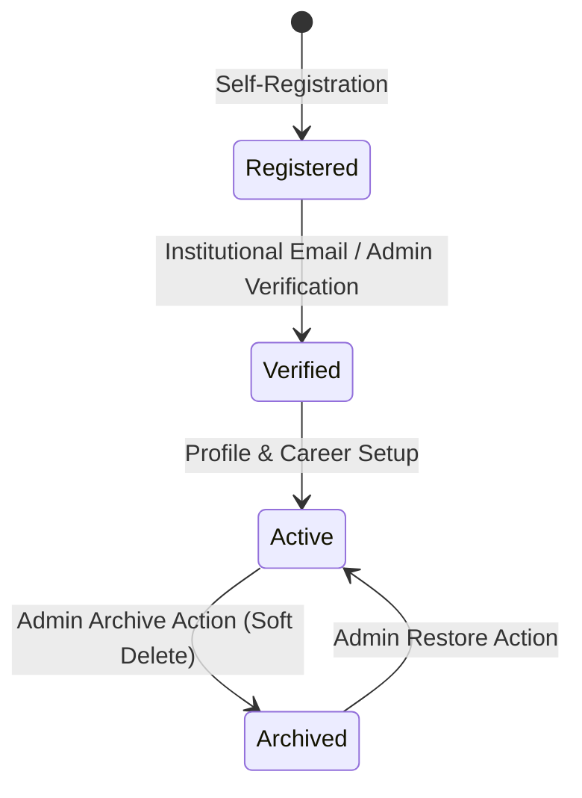

# Product Requirements Document (PRD)
## Alumni Information Career Tracking System (AICTS)
### Polytechnic College of La Union (PCLU)

---

## 1. Product Overview & Objectives

The **Alumni Information Career Tracking System (AICTS)** is the flagship digital platform for the **Polytechnic College of La Union (PCLU)**, designed to monitor graduate outcomes, assess employment rates, connect alumni with partner employers, and generate institutional analytics for accreditation and continuous curriculum improvement.

Operating in **Academic Year 2025–2026** (Calendar Year **2026**), the platform acts as the single source of truth for institutional career trajectories, CHED/accreditation reporting metrics, and job placement services.

### Core Objectives
1. **Accurate Institutional Analytics**: Provide real-time, mathematically rigorous tracking of graduate employment rates, industry distributions, and batch cohort trajectories leading up to 2026.
2. **Data Preservation & Archival Lifecycle**: Guarantee data integrity through strict soft-delete and archival patterns. No graduate's academic history, career milestones, or communications are permanently destroyed on account deactivation.
3. **Graduate Career Mobility**: Empower alumni to maintain verified career histories, download resumes, and discover career opportunities from vetted regional and national employers.
4. **Employer Collaboration**: Enable verified industry partners to publish vetted job postings and recruit PCLU graduates under administrative oversight.

---

## 2. User Personas & Roles

| Role | Target Audience | Primary Capabilities |
|---|---|---|
| **Alumni** | PCLU Graduates (2000–2026) | Profile customization, career milestone logging, job applications, messaging, and event engagement. |
| **Employer** | Corporate Recruiters & HR Officers | Company profile management, job posting creation (pending admin review), applicant tracking, and direct alumni outreach. |
| **Admin** | PCLU Alumni Relations & Career Center | Full system oversight, employer vetting, job posting moderation, alumni account archival/restoration, announcement publishing, and CHED-standard analytics generation. |

---

## 3. Account Lifecycles & State Machines

### 3.1 Alumni Account Lifecycle

- **Active**: `profiles.is_active = true`, `alumni.is_profile_public = true`. Visible in networking directory, can apply to jobs, included in active analytics.
- **Archived (Soft-Deleted)**: `profiles.is_active = false`, `alumni.is_profile_public = false`. All career records, applications, and logs are preserved. Account cannot log in until restored by an administrator. Excluded from active student/alumni count metrics.
- **Restored**: Re-activated by admin (`is_active = true`). Immediately regains platform access with full historical data intact.

### 3.2 Employer Account Lifecycle
- **Pending**: Awaiting administrative review and business permit verification.
- **Approved**: Verified by admin (`approval_status = "approved"`, `profiles.is_active = true`). Can post jobs.
- **Rejected**: Denied with a recorded rejection reason and automated notification.
- **Archived / Deactivated**: Soft-deleted by admin (`profiles.is_active = false`). Postings unpublished, can be restored from the "Recently Deleted" tab.

### 3.3 Job Posting Lifecycle
- **Pending** -> **Active** (Approved by Admin) -> **Expired** (Passes `expires_at` date in 2026) -> **Closed** (Filled by Employer).

---

## 4. 2026 Institutional Analytics Specifications

### 4.1 Temporal Awareness
- **Active System Year**: 2026
- **Current Academic Year**: AY 2025–2026 (First / Second Semester)
- **Batch Years Monitored**: 2000 through 2026 (Cohorts 2022–2026 tracked as trailing high-focus cohorts).

### 4.2 Mathematical Formulas for Accurate Analytics
1. **Active Registered Alumni ($N_{\text{alumni}}$)**:
   $$\text{Total Active Alumni} = \sum \text{Profiles where } (\text{role} = \text{'alumni'} \land \text{is\_active} = \text{true})$$
2. **Reported Alumni ($N_{\text{reported}}$)**:
   Unique active alumni who have submitted at least one current, non-archived career record.
3. **Employed Alumni ($N_{\text{employed}}$)**:
   Unique active alumni with current career status in $\{\text{'employed'}, \text{'self\_employed'}, \text{'ofw'}\}$.
   *Crucial rule*: An alumnus with multiple active jobs must be counted exactly **once** ($N=1$) to prevent percentage inflation.
4. **Cohort Employment Rate**:
   $$\text{Rate}_{\text{batch}} = \frac{N_{\text{employed, batch}}}{N_{\text{reported, batch}}} \times 100\%$$
5. **Active Job Postings**:
   $$\text{Active Jobs} = \sum \text{Jobs where } (\text{status} = \text{'active'} \land \text{expires\_at} > \text{now()})$$

---

## 5. Non-Functional Requirements
- **Security & Authorization**: Supabase Row-Level Security (RLS) and server-side session role verification. Service role keys restricted strictly to privileged server contexts.
- **Performance**: Sub-second dashboard loading with parallelized database queries and optimistic UI updates.
- **Audit Compliance**: All administrative state changes (approvals, rejections, archives, restorations) must produce structured audit logs in `audit_logs`.
