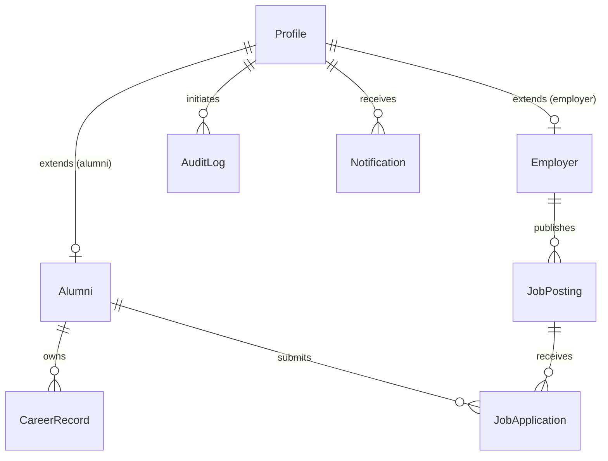

# Database Schema & Data Dictionary
## Alumni Information Career Tracking System (AICTS)

---

## 1. Core Entity Relationship Diagram

---

## 2. Table Specifications

### 2.1 `profiles` (Root Identity Table)
Extends Supabase `auth.users`. Contains shared profile attributes across all roles.

| Column | Type | Constraints | Description |
|---|---|---|---|
| `id` | `UUID` | Primary Key | References `auth.users.id` |
| `role` | `VARCHAR` | `'alumni' \| 'admin' \| 'employer'` | Security role of the account |
| `full_name` | `VARCHAR` | NOT NULL | User's display name |
| `email` | `VARCHAR` | UNIQUE, NOT NULL | Primary email address |
| `phone` | `VARCHAR` | NULLABLE | Contact telephone |
| `profile_photo_url` | `TEXT` | NULLABLE | Storage bucket asset URL |
| `cover_photo_url` | `TEXT` | NULLABLE | Storage bucket asset URL |
| `is_verified` | `BOOLEAN` | DEFAULT `false` | Email / identity verification flag |
| `is_active` | `BOOLEAN` | DEFAULT `true` | **Soft-delete & Archival Flag**. `false` indicates archived. |
| `birthdate` | `DATE` | NULLABLE | User birthdate |
| `is_searchable` | `BOOLEAN` | DEFAULT `true` | Directory discoverability |
| `created_at` | `TIMESTAMPTZ` | DEFAULT `now()` | Registration timestamp |
| `updated_at` | `TIMESTAMPTZ` | Auto-updating | Record last modified |

---

### 2.2 `alumni` (Graduate Sub-entity)
Extends `profiles` for alumni role users.

| Column | Type | Constraints | Description |
|---|---|---|---|
| `id` | `UUID` | Primary Key, FK `profiles.id` | Cascades delete if parent dropped |
| `student_id` | `VARCHAR` | UNIQUE, NULLABLE | PCLU Student Identification Number |
| `course` | `VARCHAR` | NOT NULL | PCLU Degree Program |
| `major` | `VARCHAR` | NULLABLE | Program specialization |
| `batch_year` | `INT` | NOT NULL | Entry/Cohort year (2000–2026) |
| `graduation_year` | `INT` | NOT NULL | Year graduated from PCLU (2004–2026) |
| `address` | `TEXT` | NULLABLE | Home address |
| `city` | `VARCHAR` | NULLABLE | Residence city/municipality |
| `province` | `VARCHAR` | NULLABLE | Residence province |
| `linkedin_url` | `TEXT` | NULLABLE | Professional networking profile |
| `resume_url` | `TEXT` | NULLABLE | Supabase storage link to PDF resume |
| `is_profile_public` | `BOOLEAN` | DEFAULT `true` | Directory public visibility flag |

---

### 2.3 `employers` (Corporate Sub-entity)
Extends `profiles` for company partners.

| Column | Type | Constraints | Description |
|---|---|---|---|
| `id` | `UUID` | Primary Key, FK `profiles.id` | References `profiles.id` |
| `company_name` | `VARCHAR` | NOT NULL | Business entity name |
| `industry` | `VARCHAR` | NOT NULL | Industry sector |
| `company_size` | `VARCHAR` | NULLABLE | Employee count band |
| `business_permit_number` | `VARCHAR` | NULLABLE | Municipal/DTI permit registration |
| `company_website` | `TEXT` | NULLABLE | Corporate URL |
| `approval_status` | `VARCHAR` | DEFAULT `'pending'` | `'pending' \| 'approved' \| 'rejected'` |
| `rejection_reason` | `TEXT` | NULLABLE | Explanation if disapproved |
| `approved_at` | `TIMESTAMPTZ` | NULLABLE | Admin approval timestamp |
| `approved_by` | `UUID` | FK `profiles.id` | Admin who granted approval |

---

### 2.4 `career_records` (Employment Milestones)

| Column | Type | Constraints | Description |
|---|---|---|---|
| `id` | `UUID` | Primary Key | UUID identifier |
| `alumni_id` | `UUID` | FK `alumni.id` | Owner alumnus |
| `employment_status` | `VARCHAR` | NOT NULL | `'employed' \| 'self_employed' \| 'unemployed' \| 'ofw' \| 'further_study' \| 'retired'` |
| `employer_name` | `VARCHAR` | NULLABLE | Company or organization name |
| `job_title` | `VARCHAR` | NULLABLE | Position title |
| `industry` | `VARCHAR` | NULLABLE | Economic sector |
| `start_date` | `DATE` | NULLABLE | Employment start |
| `end_date` | `DATE` | NULLABLE | Employment end (null if current) |
| `is_current` | `BOOLEAN` | DEFAULT `true` | Current employment flag |
| `is_archived` | `BOOLEAN` | DEFAULT `false` | **Career record soft-delete flag** |
| `archived_at` | `TIMESTAMPTZ` | NULLABLE | Timestamp when record was archived |

---

### 2.5 `audit_logs` (System Traceability)
Tracks all security and data modifications.

| Column | Type | Description |
|---|---|---|
| `id` | `UUID` | Unique event ID |
| `user_id` | `UUID` | Actor profile ID (null for system crons) |
| `action` | `VARCHAR` | Action code (e.g. `ARCHIVE_ALUMNI`, `RESTORE_ALUMNI`) |
| `table_name` | `VARCHAR` | Modified database entity |
| `record_id` | `UUID` | ID of target entity |
| `old_values` | `JSONB` | State prior to modification |
| `new_values` | `JSONB` | State post-modification |
| `created_at` | `TIMESTAMPTZ` | Event timestamp |
